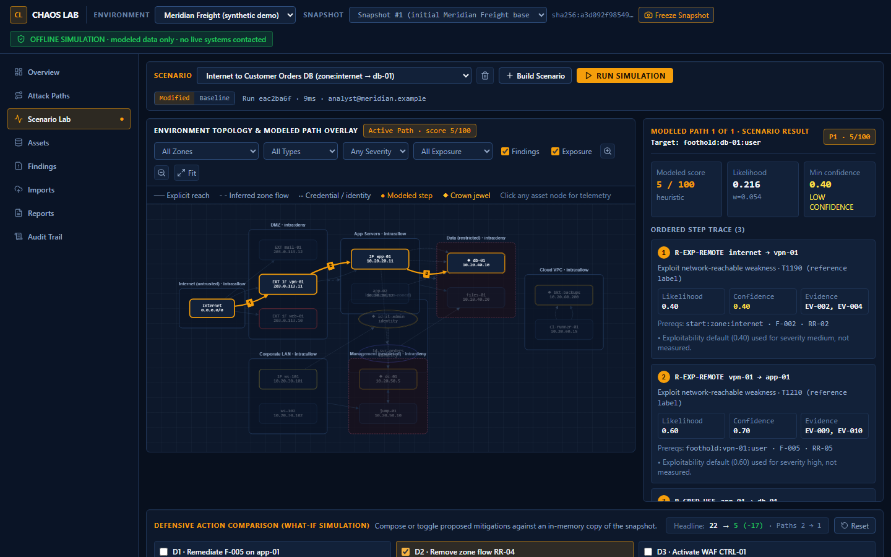

# CHAOS LAB

Self-hosted offline attack-path simulation and defensive scenario lab.

CHAOS LAB models multi-hop exposure over infrastructure you already document or scan:

- Import environments from JSON bundles, CSV inventory tables, or existing Nmap XML (`-oX`) scans.
- Freeze point-in-time environments into immutable, SHA-256-addressed **snapshots**.
- Trace deterministic, explainable **modeled attack paths** with rule prerequisites, supporting evidence excerpts, and confidence weights.
- Test **what-if defensive actions** (finding remediation, zone isolation, firewall rule removal, compensating controls) against an in-memory snapshot copy before touching live infrastructure.



> **Offline safety boundary:** CHAOS LAB runs strictly on imported or synthetic data. It never sends network packets, probes live hosts, executes exploit payloads, or stores raw credentials. All outputs are labeled as modeled results rather than proof of exploitability.

## Quickstart (Docker Compose)

Prerequisites: Docker Desktop / Docker Engine with Compose v2.

```powershell
cp .env.example .env
# Edit .env to set >=32-char CHAOSLAB_SECRET_KEY and URL-safe POSTGRES_PASSWORD
# (set CHAOSLAB_AUTO_SEED_DEMO=true if you want the synthetic Meridian Freight workspace seeded on boot)
docker compose up -d --build
```

Open `http://127.0.0.1:8080`.

Common management commands:

```powershell
# Bootstrap your first administrator (when CHAOSLAB_AUTO_SEED_DEMO=false)
docker compose exec api python -m chaoslab create-admin --email admin@your-org.example --name "Security Admin"

# Optional synthetic demo dataset
docker compose exec api python -m chaoslab seed-demo

# Verify tamper-evident audit hash chain
docker compose exec api python -m chaoslab verify-audit

# Retention check (dry-run by default; add --apply to purge expired records)
docker compose exec api python -m chaoslab run-retention --json
```

See [Deployment & Operations](docs/deployment.md) for reverse-proxy TLS configuration, PostgreSQL backups, and container isolation details.

## Local Development (Without Docker)

### Backend API & CLI (`backend/`)

```powershell
python -m venv .venv
.\.venv\Scripts\Activate.ps1
pip install -e ".[dev]"

python -m chaoslab init-db
python -m chaoslab seed-demo     # or `create-admin` for a clean non-demo workspace
uvicorn chaoslab.api.app:get_asgi_app --factory --reload --host 127.0.0.1 --port 8000
```

### Web Console (`frontend/`)

```powershell
npm install
npm run dev
```

Open `http://127.0.0.1:5173` (Vite proxies `/api/*` to `http://127.0.0.1:8000`).

Synthetic demo credentials (change or disable demo users before shared access):

- **Admin:** `admin@meridian.example` / `ChaosAdmin!2026`
- **Analyst:** `analyst@meridian.example` / `ChaosAnalyst!2026`
- **Viewer:** `viewer@meridian.example` / `ChaosViewer!2026`

## Repository Layout

- `backend/`: FastAPI modular monolith (`chaoslab/`), Alembic migrations, and pytest suite
  - `chaoslab/analysis/`: pure stdlib-only graph model, rule catalog (`2026.11-r1`), uniform-cost search, scoring, and defensive comparisons
  - `chaoslab/api/`: FastAPI routers, Pydantic v2 schemas, security headers
  - `chaoslab/auth/`: argon2id password hashing, SHA-256-hashed HTTP-only sessions, CSRF header guard, RBAC matrix
  - `chaoslab/audit/`: append-only SHA-256 hash-chained audit events
  - `chaoslab/imports/`: size-capped upload validation, `defusedxml`-hardened Nmap XML parsing, CSV/JSON upserts, and formula-safe exports
  - `chaoslab/inventory/` & `chaoslab/snapshots/`: provenance-tracked inventory models and canonical snapshot repository
  - `chaoslab/scenarios/` & `chaoslab/demo/`: scenario run persistence, defensive comparison APIs, and *Meridian Freight* fixtures
  - `chaoslab/reporting/` & `chaoslab/retention.py`: auto-escaped HTML/Markdown report rendering and reference-safe retention sweeps
- `frontend/`: React 18, TypeScript, Vite, TanStack Query, Tailwind CSS, Cytoscape.js topology UI, and Playwright E2E suite
- `deploy/` & `docker-compose.yml`: unprivileged Nginx proxy, internal no-egress API network, and PostgreSQL 16 service
- `docs/`: architecture specs, analysis math, security boundaries, engineering notes, and walkthrough

## Testing & Verification

Backend (from `backend/`):

```powershell
ruff check chaoslab tests
pytest -v
```

To include live embedded PostgreSQL 16 parity tests (`test_postgresql_runtime.py`) locally without Docker, install the optional `pgtest` extras (`pip install -e ".[dev,pgtest]"`).

Frontend (from `frontend/`):

```powershell
npm run typecheck
npm run test
npm run build
npm run test:e2e
```

CI checks (live `postgres:16-alpine` tests, Chromium Playwright E2E, and Docker Compose build + no-egress validation) run automatically via [.github/workflows/ci.yml](.github/workflows/ci.yml).

## Documentation

- [Deployment & Operations](docs/deployment.md)
- [Architecture](docs/architecture.md)
- [Analysis Model](docs/analysis-model.md)
- [Data Model](docs/data-model.md)
- [Import & Export Formats](docs/import-formats.md)
- [Safety Boundaries](docs/safety-boundaries.md)
- [Application Threat Model](docs/threat-model.md)
- [Data Handling & Retention](docs/data-handling.md)

## License

[MIT](LICENSE)
