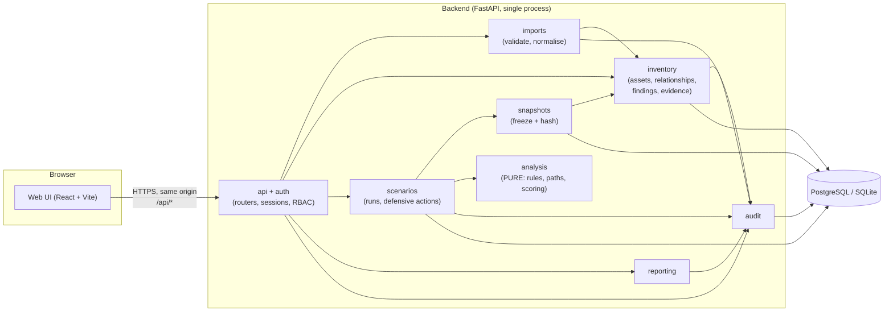
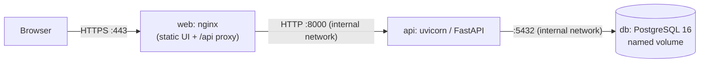

# CHAOS LAB: Architecture

Modular monolith architecture for offline attack-path simulation. Features noted as *future* belong to the post-initial-release roadmap and are not implemented in code.

## 1. Shape: a modular monolith

One deployable backend (Python / FastAPI), one single-page web UI (React), one relational database
(PostgreSQL in deployment, SQLite for zero-install development and tests). No message brokers, no
microservices, no graph database.



## 2. Backend packages and boundaries

All code lives under `backend/chaoslab/`. Each package owns its tables and exposes a small service
API; routers never touch another package's tables directly.

| Package | Responsibility | May depend on |
|---|---|---|
| `api/` | HTTP routers, request/response schemas, error mapping | every service package, `auth` |
| `auth/` | users, password hashing (argon2), sessions, roles → permissions, `require(permission)` dependency | `db`, `audit` |
| `imports/` | file intake limits, parsing (CSV, JSON, Nmap XML), schema validation with row-level errors, normalisation into inventory commands | `inventory`, `audit` |
| `inventory/` | zones, assets, services, relationships, reachability rules, findings, evidence, controls; provenance on every row | `db` |
| `snapshots/` | freeze an environment into a canonical, content-hashed document; `GraphRepository` interface | `inventory` |
| `analysis/` | **pure** deterministic engine: domain model, rule catalogue, reachability, path search, scoring, explanations | Python stdlib only |
| `scenarios/` | scenario definitions, defensive actions (in-memory mutations of a snapshot), run records, before/after comparison | `snapshots`, `analysis`, `audit` |
| `reporting/` | render a run/environment report (HTML + Markdown), record exports | `scenarios`, `inventory`, `audit` |
| `audit/` | append-only, hash-chained audit events | `db` |

### The purity rule for `analysis/`

`chaoslab/analysis` imports only the Python standard library allow-list (`dataclasses`, `enum`,
`typing`, `math`, `heapq`, `hashlib`, `json`, `itertools`, `functools`, `collections`) and its own
modules. It performs no I/O: no database, no files, no sockets, no clock, no randomness. A test
(`tests/test_analysis_purity.py`) parses its source with `ast` and fails the build if this rule is
broken. This is the main technical guarantee behind "simulation produces no external activity" —
see [safety-boundaries.md](safety-boundaries.md).

### Graph persistence behind an interface

```python
class GraphRepository(Protocol):
    def load_snapshot(self, snapshot_id: str) -> EnvironmentModel: ...
    def create_snapshot(self, environment_id: str, created_by: str) -> SnapshotRecord: ...
```

The current implementation reads relational tables and stores frozen snapshots as canonical JSON (`snapshots.document`, sha256-addressed). The analysis engine sees only the in-memory `EnvironmentModel`. Swapping to a graph database later only requires a new `GraphRepository` implementation, without engine changes.

## 3. Key flows

**Import.** Upload → size/type limits → parse (no external entity resolution, no formula
evaluation) → validate against schema → *dry-run report* (row-level errors and warnings) → commit
in one transaction → inventory rows carry `origin=imported`, `source`, `observed_at`, `confidence`,
`import_batch_id` → audit event.

**Analysis / scenario run.** Choose environment → create or pick a snapshot (frozen, hashed) →
define scenario (start position, target asset(s), attacker assumptions, limits) → optionally add
defensive actions → engine runs on the in-memory model of the snapshot (+ mutated copy for actions)
→ run record stores inputs, engine & rule-set versions, snapshot hash, results, result hash →
audit event. Re-running the same inputs must reproduce the same result hash.

**Read paths (UI).** Inventory pages read the *working set* (live, editable). Scenario Lab and
attack path pages read a *snapshot* and say which one, with its hash.

## 4. Authentication and authorisation

- Local accounts, argon2id password hashes, opaque random session tokens stored hashed
  server-side, delivered in an `HttpOnly; Secure; SameSite=Strict` cookie. Future: OIDC.
- State-changing requests additionally require the `X-Requested-With: chaoslab` header (CSRF
  defence-in-depth alongside SameSite).
- Roles map to permissions in one table in code (`auth/permissions.py`); every router endpoint
  declares `Depends(require("<permission>"))`. The UI hides controls for convenience only.

| Permission | viewer | analyst | admin |
|---|:-:|:-:|:-:|
| `inventory:read`, `findings:read`, `scenarios:read`, `reports:read` | ✓ | ✓ | ✓ |
| `findings:write` (status, notes), `inventory:write` (manual edits) | | ✓ | ✓ |
| `imports:write`, `snapshots:create`, `scenarios:run`, `reports:export` | | ✓ | ✓ |
| `audit:read` | | ✓ | ✓ |
| `admin:users`, `admin:settings`, `environments:manage` | | | ✓ |

## 5. Deployment (target: self-hosted, single organisation)



- `docker-compose.yml` with three services on an internal network; only `web` publishes a port.
- Configuration and secrets via environment variables / `.env` (git-ignored) or Docker secrets;
  `.env.example` documents every variable without values.
- The backend makes **no outbound network calls**. Operators can run the `api` container on an isolated network with zero egress.
- Development without Docker: `uvicorn` + SQLite + `vite dev` (proxy `/api`).

## 6. Technology choices (summary)

| Concern | Choice | Notes |
|---|---|---|
| Backend | Python 3.11+, FastAPI, Pydantic v2 | modular monolith packages under `chaoslab/` |
| ORM / migrations | SQLAlchemy 2.0, Alembic | portable types only (works on SQLite and PostgreSQL) |
| Database | PostgreSQL 16 (deploy), SQLite (dev/test) | canonical JSON snapshots behind `GraphRepository` |
| Frontend | React 18 + TypeScript + Vite, TanStack Query, Tailwind | dark navy operations console |
| Graph rendering | Cytoscape.js (compound nodes for zones) | |
| Tests | pytest (+ FastAPI TestClient), Vitest, Playwright | |
| First integration | Nmap XML (`-oX`) file import | `defusedxml` offline scan parser |
