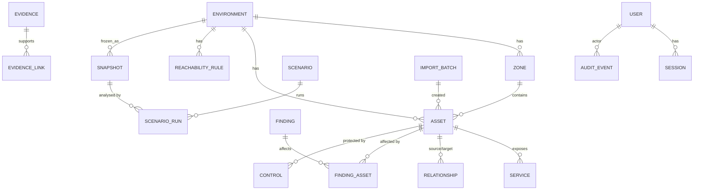

# CHAOS LAB: Data Model

Tables are SQLAlchemy models in `backend/chaoslab/*/models.py`, migrated with Alembic using portable column types (PostgreSQL and SQLite).

## 1. Conventions

- Primary keys: `id` = UUID string. Human-facing `key` (e.g. `web-01`, `F-001`, `EV-014`) is
  unique **per environment** and is what imports, snapshots and explanations use.
- Timestamps: UTC, ISO 8601, timezone-aware.
- **Provenance mixin** on every inventory fact (zones, assets, services, relationships,
  reachability rules, findings, controls, evidence):

| Column | Meaning |
|---|---|
| `origin` | `imported` · `manual` · `inferred` |
| `source` | where it came from, e.g. `synthetic:meridian-freight@1`, `csv:assets.csv`, `nmap:scan-2026-11-02.xml`, `user:alice` |
| `observed_at` | when the fact was true according to the source (not when it was stored) |
| `confidence` | 0.0–1.0, how much we trust the fact |
| `import_batch_id` | nullable FK to the import that created/last updated it |
| `created_at`, `updated_at`, `updated_by` | bookkeeping |

Facts the engine derives at run time (e.g. reachability through a zone-wide rule) are not stored
in inventory; they appear in results with `origin = inferred` and cite the facts they came from.

## 2. Entities



| Entity | Key fields (besides provenance) |
|---|---|
| `environments` | name, description, `is_demo` |
| `zones` | key, name, `trust_level` (untrusted/low/medium/high), `intra_zone_policy` (allow/deny), cidrs (informational) |
| `assets` | key, name, `type` (server, workstation, network_device, cloud_resource, data_store, application, identity), zone_id (null for identities), `criticality` 1–5, owner, hostname, ip_addresses, os, tags, description |
| `services` | asset_id, port, protocol, name, product, version |
| `relationships` | key, source_asset_id, target_asset_id, `type` (has_credential_for, admin_of, can_access, depends_on, hosts, connects_to), attributes JSON (port, required_level, access_level, material) |
| `reachability_rules` | key, source zone **or** asset, target zone **or** asset, ports (list or `*`), protocol, description |
| `findings` | key, title, `category` (remote_exploitable, local_privesc, credential_exposure, misconfiguration, informational), `severity`, `status` (open, in_progress, accepted_risk, remediated, false_positive), cwe, cve, `exploitability` (nullable), `grants` (user/admin), requires_auth, description, remediation_notes, status history |
| `finding_assets` | finding_id, asset_id, port (nullable), status override (nullable) |
| `controls` | key, name, `type` (waf, mfa, edr, segmentation, other), asset_id, `affects_rules` list, ports (nullable), `factor` 0–1, `status` (active/proposed) |
| `evidence` | key, `kind` (scanner_output, config_excerpt, firewall_export, manual_note, import_record), title, excerpt (≤ 8 KB, redacted), sha256 of excerpt |
| `evidence_links` | evidence_id, subject_type, subject_id |
| `import_batches` | format, filename, sha256, size, status (validated/committed/rejected), counts, errors JSON, created_by |
| `snapshots` | environment_id, `sha256`, `document` (canonical JSON), counts, created_by, created_at, label |
| `scenarios` | environment_id, name, start, targets, parameters, created_by |
| `scenario_runs` | scenario_id, snapshot_id, actions JSON, engine_version, ruleset_version, `input_sha256`, `result_sha256`, result JSON, status, duration_ms, created_by |
| `users` | email, display_name, password_hash (argon2id), role, is_active, last_login_at |
| `sessions` | user_id, token_sha256, created_at, expires_at, last_seen_at, ip, user_agent |
| `audit_events` | seq, at, actor_user_id, action, subject_type, subject_id, details JSON, `prev_hash`, `hash` |

## 3. Snapshots

A snapshot freezes one environment's working set into a **canonical JSON document**:

```json
{
  "schema_version": 1,
  "environment": {"id": "...", "name": "Meridian Freight (synthetic demo)"},
  "zones": [...], "assets": [...], "services": [...], "relationships": [...],
  "reachability": [...], "findings": [...], "controls": [...], "evidence": [...]
}
```

- Every list is sorted by `key`; objects are serialised with sorted keys and no insignificant
  whitespace. `sha256` of that byte string identifies the snapshot. The creation time is stored
  beside the document, not inside it, so identical content yields an identical hash.
- Snapshots are immutable. Scenario runs reference a snapshot, never the live working set.
- Evidence excerpts are included so a report can be produced from the snapshot alone.

## 4. Audit events

Append-only. Each event stores `hash = sha256(prev_hash || canonical_json(event))`. A
verification endpoint (`GET /api/audit/verify`, admin) recomputes the chain. This makes tampering
by an application-level actor visible; it does not stop a database administrator from rewriting
the whole chain (documented in [threat-model.md](threat-model.md)).

Recorded actions (minimum): `auth.login`, `auth.login_failed`, `auth.logout`, `import.validated`,
`import.committed`, `import.rejected`, `inventory.*.created/updated/deleted`,
`finding.status_changed`, `snapshot.created`, `scenario.run`, `report.exported`,
`admin.user_created/updated/disabled`, `admin.role_changed`, `admin.settings_changed`.
