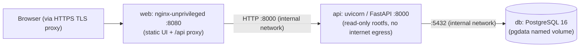

# CHAOS LAB: Deployment & Operations

This guide covers both the **hardened Docker Compose deployment** (recommended for a
self-hosted, single-organisation setup) and **local development** without Docker.

---

## 1. Self-Hosted Deployment Architecture (Docker Compose)



Security properties enforced by [docker-compose.yml](../docker-compose.yml):
- **No external egress for `api` or `db`:** Both services join only the `internal` network
  (`internal: true`) and publish zero host ports.
- **Least-privilege runtime:** `api` runs as non-root UID `10001`, `web` uses
  `nginxinc/nginx-unprivileged`, and both mount read-only root filesystems (`read_only: true`), drop
  all Linux capabilities (`cap_drop: [ALL]`), and set `no-new-privileges:true`.
- **Single local ingress:** `web` binds `127.0.0.1:${CHAOSLAB_PORT:-8080}:8080` so an upstream
  TLS-terminating reverse proxy (Caddy, Nginx, Traefik, or cloud load balancer) handles HTTPS.

---

## 2. Quickstart with Docker Compose

### Step 1: Configure `.env` with strong secrets

```bash
cp .env.example .env
```

Generate strong secrets (32+ chars) and fill them in `.env` (never commit `.env`):

```bash
python -c "import secrets; print('CHAOSLAB_SECRET_KEY=' + secrets.token_urlsafe(48))"
python -c "import secrets; print('POSTGRES_PASSWORD=' + secrets.token_urlsafe(32))"
```

Recommended production values in `.env`:
- `CHAOSLAB_ENV=production`
- `CHAOSLAB_COOKIE_SECURE=true` (requires HTTPS at your reverse proxy)
- `CHAOSLAB_CORS_ORIGINS=["https://chaoslab.your-domain.example"]`
- `CHAOSLAB_AUTO_SEED_DEMO=false` (set `true` only for a demo sandbox)

> **Startup invariant:** In `production` mode (`CHAOSLAB_ENV=production`), the API refuses to start
> if `CHAOSLAB_SECRET_KEY` is empty, default, or shorter than 32 characters.

### Step 2: Build and start services

```bash
docker compose up -d --build
```

At startup, [backend/docker-entrypoint.sh](../backend/docker-entrypoint.sh) automatically runs
`python -m chaoslab init-db` (`alembic upgrade head`) before starting Uvicorn.

### Step 3: Create your first administrator & verify readiness

Check readiness from the host:

```bash
curl -s http://127.0.0.1:8080/api/health/ready
```

For real environments (`CHAOSLAB_AUTO_SEED_DEMO=false`), create your first administrator account:

```bash
docker compose exec api python -m chaoslab create-admin --email admin@your-org.example --name "Security Admin"
```

Or seed the synthetic **Meridian Freight** demo dataset (`CHAOSLAB_AUTO_SEED_DEMO=true` also runs
this automatically at container boot):

```bash
docker compose exec api python -m chaoslab seed-demo
```

If seeding demo data for an evaluation sandbox, immediately rotate the seeded demo passwords or
disable demo accounts via the **Admin** UI tab before granting team access.

> **Windows (Docker Desktop):** Use the WSL 2 backend, keep `POSTGRES_PASSWORD` URL-safe (avoid
> `@`, `:`, `/`, `?`, `#`, `%`), and wait until the Docker Desktop tray icon shows **Engine
> running** before running `docker compose` commands. Keep `CHAOSLAB_COOKIE_SECURE=false` when
> browsing locally over `http://127.0.0.1:8080`, and switch to `true` behind HTTPS.

---

## 3. Reverse Proxy & TLS Checklist

Terminate TLS in front of `127.0.0.1:8080` so browser sessions stay protected by
`HttpOnly; Secure; SameSite=Strict`:

1. Forward `Host`, `X-Real-IP`, `X-Forwarded-For`, and `X-Forwarded-Proto: https`.
2. Ensure client upload limits match or exceed CHAOS LAB's 10 MB upload cap (`11m` in `nginx.conf`).
3. Keep `CHAOSLAB_COOKIE_SECURE=true` over HTTPS (set `false` only for plain `http://localhost`
   local evaluation).

---

## 4. Operations: Retention, Audit Verification & Backups

### Verify audit hash chain integrity

```bash
docker compose exec api python -m chaoslab verify-audit
```

Returns exit code `0` when every `AuditEvent` hashes cleanly from `GENESIS`, or `1` if any record
was modified or removed.

### Run data retention sweeps (dry-run by default)

```bash
# Dry-run inspection (safe, read-only)
docker compose exec api python -m chaoslab run-retention --json

# Apply cleanup (expired sessions past grace window, aged runs, unreferenced aged snapshots)
docker compose exec api python -m chaoslab run-retention --apply
```

Snapshots referenced by active or retained `scenario_runs` are automatically protected; live
`audit_events` rows are never deleted automatically so hash-chain verification remains intact.

### PostgreSQL backups

```bash
docker compose exec -T db pg_dump -U chaoslab chaoslab > chaoslab-backup-$(date +%F).sql
```

Store backups encrypted at rest because inventory and attack-path outputs represent sensitive
internal risk maps (see [data-handling.md](data-handling.md)).

---

## 5. Local Development (Zero External Dependencies)

For day-to-day local work without Docker or PostgreSQL:

```powershell
# Terminal 1 (Backend API + SQLite)
cd backend
python -m venv .venv
.\.venv\Scripts\Activate.ps1
pip install -e ".[dev]"
python -m chaoslab init-db
python -m chaoslab seed-demo
uvicorn chaoslab.api.app:get_asgi_app --factory --reload --host 127.0.0.1 --port 8000

# Terminal 2 (Frontend Vite dev console)
cd frontend
npm install
npm run dev
```

Open `http://127.0.0.1:5173`.

### Live PostgreSQL 16 verification without Docker

To run the full Alembic + SQLAlchemy + API parity suite against an embedded live PostgreSQL 16
cluster (`pgserver` + `psycopg` v3, zero root/admin privileges required):

```powershell
cd backend
.\.venv\Scripts\Activate.ps1
pip install -e ".[dev,pgtest]"
pytest tests/test_postgresql_runtime.py -v
```

### Real-browser E2E suite & automated CI

Run Playwright against an isolated backend instance (ports `8011` API / `5174` preview):

```powershell
cd frontend
npm run test:e2e
```

[.github/workflows/ci.yml](../.github/workflows/ci.yml) automates all three verification stages on CI
runners: live `postgres:16-alpine` backend tests, Chromium Playwright E2E, and live Docker Compose
build + `/api/health/ready` + internal no-egress verification.
